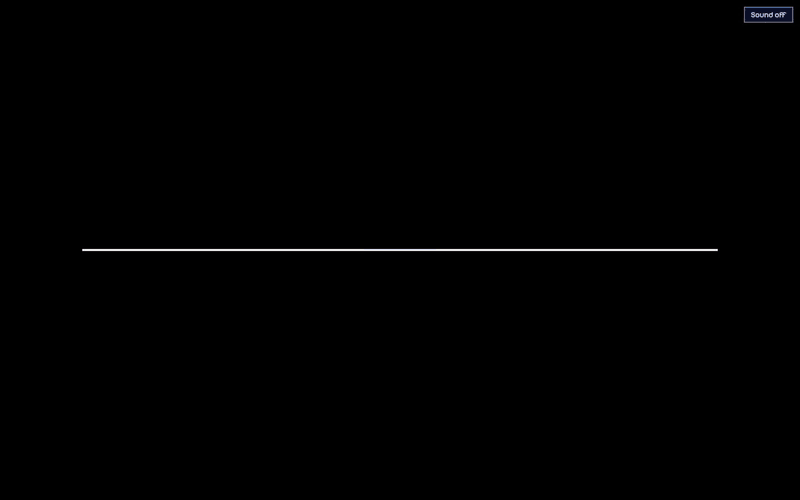
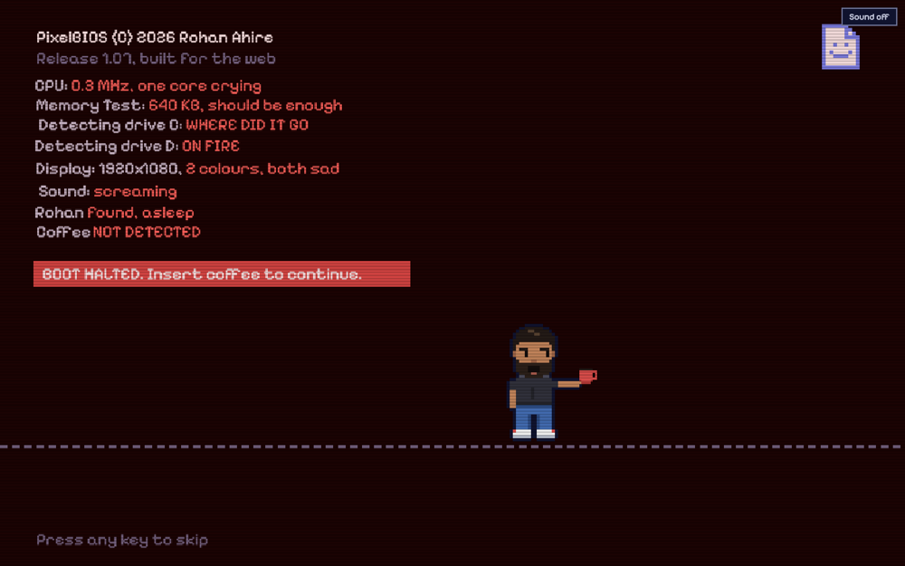
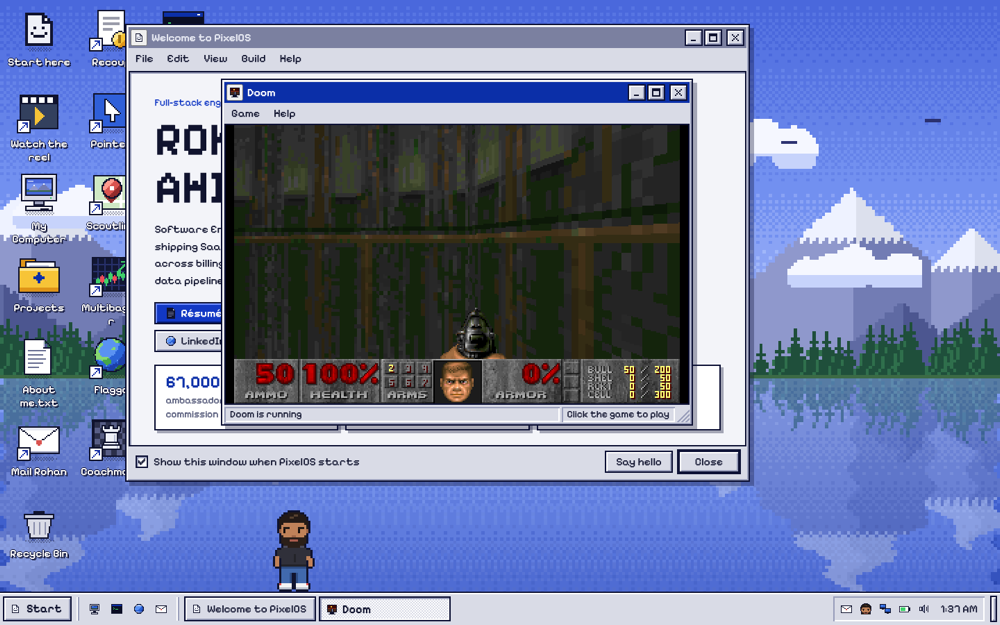
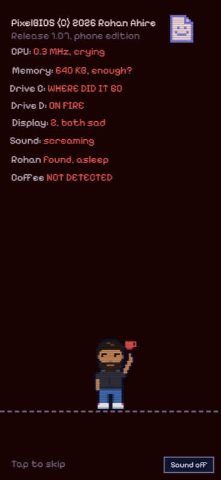

# PixelOS

The source of [rohanahire.com](https://rohanahire.com), my portfolio. It's a pixel-art desktop computer that runs in the browser: it boots, opens real windows, and my projects, resume and contact details live inside it as files and apps.



Phones get a separate, simpler site (`phone.html`).

| The boot screen | Doom in a window | The boot on a phone |
|---|---|---|
|  |  |  |

## What's on the desktop

There are 20 apps, including a file explorer, a terminal, Paint, Minesweeper, a mail client, a chiptune player and a web browser. Windows drag, snap, resize, minimize and maximize, and Alt+Tab switches between them. The terminal is a command line with history and tab completion over a pretend file system.

A small pixel version of me lives on the taskbar. It walks around, codes, naps and reacts to what you open. It can give you a tour, you can pick it up and throw it, and it ducks behind the taskbar when a window covers it.

`js/data.js` holds my actual projects, so the files on the desktop are real content.

## What's technically interesting

### No framework and no build step

The site is about 8,200 lines of plain JavaScript in ES modules and 940 lines of CSS, served as static files. `js/wm.js` is a window manager written from scratch, covering focus, snapping, modal dialogs and message boxes. Each app is a dynamic import in `js/apps/index.js`, so its code only loads when you open it.

### All the art is code

Every icon, cursor and sprite on the desktop is drawn by `js/px.js` and `js/me-sprite.js`. The wallpaper in `js/wallpaper.js` is a Bayer-dithered lake that follows your clock through day, sunset and night. The animations share one ticker at about 12.5 fps, which stops while the tab is hidden. Sound effects and the three chiptune tracks are synthesized live with Web Audio.

### A boot film that hands over to the real desktop

The boot in `js/film/coffee-panic.js` is a short film drawn on canvas. The BIOS panics because coffee is not detected, you click to throw a mug, and a wash of coffee melts the screen away. The real desktop opens underneath while the film is still playing, and the overlay turns see-through so the wash runs over live windows.

Scenes never touch the page and the player in `js/film/player.js` never draws. That split is what lets the tests run every frame without a browser. Any key, click or tap skips the film, and reduced motion gets a still image. It redraws to fit any window, so it also plays on the phone site, the only film that does.

The Reel app plays a second film, One Cut (`js/film/one-cut.js`): a single continuous shot through six projects, where each project hands an object to the next.

### Real Doom

The Doom app runs the actual shareware game on js-dos, which is DOSBox compiled to WebAssembly. It sits in an iframe (`games/play.html`), and the 2.4 MB game file only loads when you open it. Minimizing the window pauses the emulator through `postMessage`.

### A browser that opens my live projects

The Pixel Navigator app (`js/apps/browser.js`) loads my deployed projects in iframes, so you can use them from inside the desktop. Those sites allow it through their own `frame-ancestors` rules.

### Tests for a project with no dependencies

`scripts/film-smoke.mjs` runs every frame of both films against a fake canvas built on a `Proxy`. `scripts/film-browser.mjs` plays them in a real browser with Playwright. `scripts/check-syntax.mjs` runs `node --check` over every JavaScript file.

## Run it locally

You need Python 3 for the file server, or any other static server.

```bash
git clone https://github.com/rohan-ahire1/pixel-desktop.git
```

```bash
cd pixel-desktop
```

```bash
python3 -m http.server 3104 --bind 127.0.0.1
```

Open <http://127.0.0.1:3104>. On a narrow window the site redirects to the phone version, and adding `?desktop` to the address keeps you on the desktop.

To run the checks that need only Node:

```bash
node scripts/check-syntax.mjs
```

```bash
node scripts/film-smoke.mjs
```

## Project layout

```text
index.html          the desktop site
phone.html          the phone site
css/                styles
js/
  main.js           startup, system keys, the shared ticker
  wm.js             window manager
  desktop.js        icon grid, drag and drop, context menus
  taskbar.js        taskbar and tray
  menu.js           start menu
  boot.js           boot sequence and screen savers
  fs.js             the pretend file system
  data.js           projects and other site content
  px.js             icons and cursors, drawn in code
  me.js             Pixel Rohan's behaviour
  me-sprite.js      Pixel Rohan's drawing
  wallpaper.js      the lake that follows the clock
  sound.js          synthesized sound effects
  inbox.js          mail that arrives during a visit
  phone.js          the phone site
  film/             the film player and both films
  apps/             the apps, each loaded on demand
games/              js-dos, Doom and the page that runs them
scripts/            checks and the deploy script
docs/readme/        the images in this README
```
